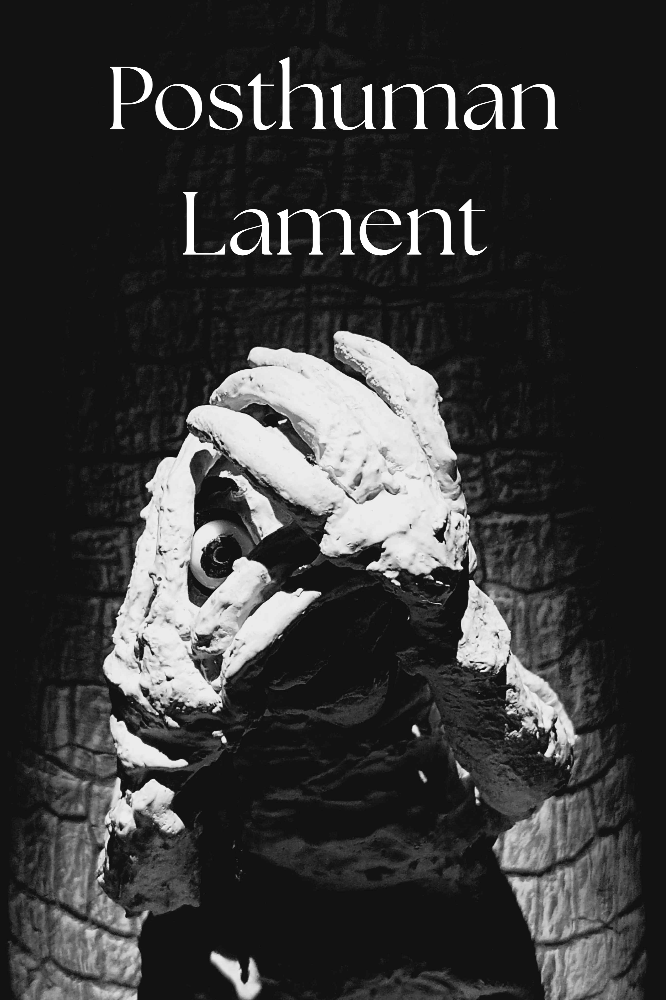

<i>[I am still working on mobile formatting, please be patient thanks!]</i>

# Posthuman Lament

Thank you for visiting my site! I just released my short film, Posthuman Lament.

[Watch the film on Youtube here](https://youtu.be/qpin5VvNtcA)

[Click here to purchase the bonus features for the film!](https://grungus600.itch.io/posthuman-lament)

# Greetings...

I'm Alex, welcome to my humble website! This is a portfolio site collecting all my weird little projects.

I'm an incredibly offline person, and don't have much internet presence outside of this website. I write film and book reviews on [Letterboxd](https://boxd.it/4mZW7) and [Goodreads](https://www.goodreads.com/user/show/164570627-alex-kuzel) respectivley, but that's pretty much it. Because all of my media analysis (and some quite good analysis at times, I'd like to think) is on those sites, my blog writing here is more essay-oriented.

P.S. Have you signed [the Guestbook?](https://alexkuzel.github.io/pages/misc)

### "Just the Hits, Please"

Here's (in my opinion) the most interesting things I've worked on (in order), if you want a quick "best of" list.

[Posthuman Lament.](https://youtu.be/qpin5VvNtcA)

The [Fear and Loathing](https://alexkuzel.github.io/pages/blogPages/orlando) blog post is without a doubt the best piece of writing I've done, I'm super proud of it

While not the most technically sophisticated sculpting I've done, I really think you'll enjoy the [Dragon Sculptures](https://alexkuzel.github.io/pages/sculptingPages/dragon_archive)

I have a LOT of miniatures painted that I feel varying levels of pride towards, but the [Hot Boys](https://alexkuzel.github.io/pages/miniaturesPages/hot_boys) are (I think) really accessible if you don't know a lot about miniatures and just want to see some plastic and say "Hell Yeah".

### New(er)sletter?

Please join my newsletter, it's good I promise! Signup is still via [My Old Site](https://alexkuzel.wixsite.com/world), but you can email me at alexkuzel.business@gmail.com and say something like "Hello please send me the newsletter, thank you and have a great day" (if you don't care how my day turns out you can omit that last part).

### References for Computer People

[Github repo](https://github.com/alexkuzel/alexkuzel.github.io)

Template for my website is based off of this [minimal Jekyll theme](https://github.com/pages-themes/minimal).