# Murder at Loveland Harbor
*Published: November 10, 2026.*

## <a href="#head1" id="header1">Table of Contents</a>

<a href="#header1" id="head1">Table of Contents</a>

<a href="#header2" id="head2">So What Actually Was Murder at Loveland Harbor?</a>

<a href="#header3" id="head3">"Seems Straightforward Enough, Why Are You Being Such a Nerd About This?"</a>

<a href="#header4" id="head4">How I Did This</a>

<a href="#header5" id="head5">Quests and Mysteries</a>

<a href="#header6" id="head6">What I Did That Totally Rocked</a>

<a href="#header7" id="head7">Bad Ideas I Killed</a>

<a href="#header8" id="head8">Balls I Dropped (Bad Ideas That Survived)</a>

<a href="#header9" id="head9">What I Learned About Interactive Media And My Friends And Isolation Is…</a>

<a href="#header10" id="head10">Lore and Spoilers</a>

<a href="#header11" id="head11">Raw Materials</a>

<a href="#header12" id="head12">Footnotes</a>

Murder at Loveland Harbor was a roleplaying game/murder mystery/scavenger hunt I created for my 2026 Halloween Party alongside my short film, [Posthuman Lament](https://youtu.be/qpin5VvNtcA). It was by far the most ambitious and well-produced thing I’ve ever made, but I don’t think it will ever be able to be experienced again, for myself or anyone reading this. I say this not to gatekeep or mourn an ephemeral piece of art, just that the initial idea for this post was to explain how you could set up this game/event, and I’m realizing the tone will actually be explaining how you won’t (or shouldn’t) run it.

This won’t be one of my better written posts, I’m just trying to cover too much ground. The rules explanation, design walkthrough, boasts and self-deprecation and general snootiness on my part is too tangled a mess to meaningfully separate, though I try. Apologies. I lived and breathed this world for a healthy few months and could talk forever about these things, so if anything is interesting in this post that’s unclear or I don’t get into enough, please let me know (alexkuzel.business@gmail.com, or however you normally contact me), and I’ll add an addendum to the post.

## <a href="#head2" id="header2">So What Actually Was Murder at Loveland Harbor?</a>
There’s going to be light spoilers in the images here, and several more when I explain the entire plot at the end, but I don’t think it matters too much as 1) if you’re the type to read my website the odds are you’d be running this event not playing it, 2) I really, really think you ought to make one of these yourself rather than recreate my experiment. Learn from my mistakes, I beg of you..

So, if you were a player, your experience of Murder at Loveland Harbor was something like this: at my Halloween party, you and 9 other people were given a large envelope (there were 11 participants total, two of them teamed up as there were only 10 characters). Inside that envelope was information about your character and the rules, a nametag, a booklet of “testimony” regarding your character to be traded with others, a journal and pen, a starting Clue, 3 additional envelopes which could be opened by completing the “quest” printed on them, and possibly a special gadget or tool<a href="#note1" id="number1">[1]</a>. For the next 3.5 hours, you hunt around my apartment for the 100+ Clues I had previously hidden, solve puzzles, cooperate or conspire with others, and open envelopes nestled deeper and deeper in your starting folder. At the end of the game, each person presents their final case; depending on their character, this might be a solution to the murder or a “how I got away with it” monologue, but each of the 10 characters had unique and very diverse objectives.

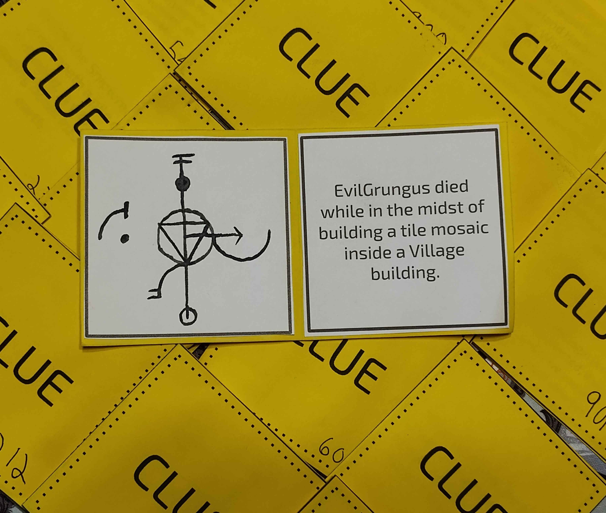

As for the narrative, I did a kind of silly amount of worldbuilding for this. The general premise is that Loveland Harbor is a (fictional) miniscule island in coastal Maine, which has just been settled by a group of forum-users obsessed with the (fictional) TV show Black Sight. In a few short weeks, food supplies dwindle and tensions rise until October 30th 2026, when the corpse of the forum’s ringleader (the party-host) is discovered. Hilarity ensues.

## <a href="#head3" id="header3">"Seems Straightforward Enough, Why Are You Being Such a Nerd About This?"</a>
Listen, you need to be *insane* to set this up and run it for your friends. If you were to download the attached files containing all Clues, character sheets, puzzles etc., much of the narrative groundwork would be laid for you, but you would still need to spend several hours cutting and pasting, figure out where to hide dozens and dozens of Clues, not to mention purchasing supplemental materials including but not limited to, ~40 manilla envelopes, a UV flashlight, magnifying glass, padlocks, traditional “key” locks, puzzle boxes, and a dozen or so nametags.

In a perfect world, some game company reaches out to me and does a production run of Murder at Loveland Harbor, so that you, the reader, could buy a fully assembled kit, and be much closer to opening a box and playing. That will never happen though, and maybe that’s for the best. As it stands, I think one of the strongest points of this event was the fact that everything was handmade by myself, I knew the ins-and-outs of all the details, and I’d like to think the painstaking love put into this project was felt by the participants, something you wouldn’t necessarily get from buying a game off the shelf. If you’re crazy enough to want to do this, I think the extra effort to create your own weird amalgamation of games is time well spent that will be appreciated by both you and your prospective party-guests, which is why I’m generally trying to walk you through the process.

## <a href="#head4" id="header4">How I Did This</a>
The very, VERY first thought in my head that kicked off this endeavour was something like “I want my friends to tear apart my apartment looking for stuff in a murder mystery”. That is to say, my thoughts began with the tactile interactions, and I carried that sentiment though. Not to say I didn’t care about the story and lore (I very much did), but the most important thing for me was the physical interaction of the game. Too many murder mysteries I had seen online involved everyone reading a booklet in a quiet room, trying to deduce the correct solution. While that makes sense from a practical standpoint, I wanted something spectacular, I wanted people to be physically moving around, discovering things, and engaging parts of their brain that were not just the “logical deduction” parts. I love a good social game (Blood on the Clocktower being a favorite of mine), and the accessibility of party games is another point of inspiration (Don’t Get Got is based on missions you do in real life, and is quite whimsical, look it up!). 

That’s another reason you might want to make something like this from scratch - knowing your audience. My friends at my Halloween party had a wide range of preferences when it comes to games, some of them are very “competitive gamer” types, and others simply hate the confrontation or bluffing that comes with social deduction games. So from the ground up I knew I would be trying to make something that catered to both extremes of that spectrum (I think I did alright in that regard, but more on that later).

The next stage in this conceptual development was a wild brainstorm of hiding locations for clues, gimmicks and puzzles, and the general archetype of characters. If you don’t know, I am head-over-heels in love with asymmetric gameplay, and one of my many personal quirks that bled through the game design was having each of the 10 characters have unique gameplay objectives and tools to get them there. If you care about chronology, all this has been happening near the end of March 2026.

Now is as good a time as any to mention term definitions (though I didn’t organize things so nicely until several months later)<a href="#note2" id="number2">[2]</a>. In Murder at Loveland Harbor, I use capital-C “Clue” to refer to any discrete piece of information in the game, which would universally appear on bright yellow squares of paper. “Objective” was eventually defined to mean the final goal(s) of each player they present at the end of the game, and a “Quest” was something printed on an envelope that someone would need to complete (and get stamped by me) to open, usually containing additional clues. I used general TTRPG parlance in referring to the “Player” as the real flesh-and-blood party-guest, and “Character” as the fictional role someone was assigned. On that note, the characters in this game were only referred to as their online username; partly because the idea of a murder mystery based on internet forum infighting was hilarious to me, but also because it made things easier to keep track of for players who might not know others in real life too well, and not have to remember “Okay so Sammy is Ryan and Katrina is Sam and Haven is also Psam but spelled with a silent ‘P’?”. A further benefit of using usernames was that it made sense for all in-game text to refer to characters with gender-neutral pronouns, which I hope allowed each player to roleplay their character as much or as little as they felt like being.

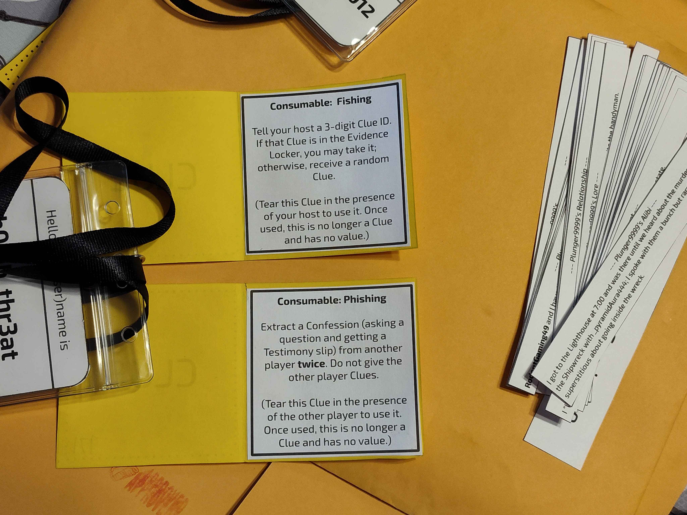

## <a href="#head5" id="header5">Quests and Mysteries</a>
So now I’ve got a loose sketch of each of the main characters and I know that my “host” character, whom I named “EvilGrungus” in reference to my actual username online, is dead. Some personal details on the character sheets have been sketched in, such as a relationship web charting how each character knows the others, but the immediate task at hand was the design of quests and mysteries. 

As mentioned above, Quests were a discrete task printed on an envelope in your character’s main envelope. Each person began with a Main quest, and a more-challenging Side quest. Within the Main Quest envelope was an additional Main Quest 2 envelope, for a total of 3 quests per person, all unique. My design process of all these quests was more than a bit infuriating, as I was constrained in several ways. Primarily, I wanted quests to be something that would be accomplished throughout the 3-4 hour game window and not have everything get accomplished in the first 5 minutes. This ran up against one of my major design philosophies, which was that as the host, I did not want to time-gate any information or require any active participation on my part besides answering questions, and stamping quests to confirm their completion.

My other constraints were that I wanted quests to make sense thematically, not be insanely difficult, and actually be enjoyable (i.e., for them to be good). Easier said than done. What I wanted to avoid here were quests that said “Locate Clue 115” as there was no guarantee all Clues would be found or that any specific Clue would get its way into a player’s hands. I also wanted people to know for sure (or have a good idea) they actually completed the quest, so no nebulous puzzles that say “when you feel like you’re correct, open the quest envelope” (requiring myself to give a stamp approval helped solve this issue too). I also did not want people to be actively hostile or manipulative in real life, such as a quest requiring you to touch another player's personal possessions without their permission.
Enough theory, here’s some examples of quests I wrote that were great. One player’s quest required them to get a picture with 6 other people, and show me the pictures before completion. Another quest involved a duo of players to pass the proper sign and countersign (secret phrase and secret response) without being intercepted by a third player who only knew the countersign. For the player who started with the UV flashlight, I filled the walls and ceiling with my apartment with UV arrows and “X” markings, the purpose of which was only revealed in their second Main Quest, leaving them to discover it early on and puzzle over the meanings until they got to that point. And many more.

“Mysteries” were my unofficial way to refer to information that someone had to be able to figure out. If a player had an incentive to learn something it was a mystery that needed Clues written to support. I began by listing all character’s primary objective, secondary objective, and quests as discrete pieces of information. Here’s a simple example (spoilers!), that the “Peptomancer” character is stealing people’s sandwiches. It’s a super tiny side-mystery, really only relevant for anyone who wants another accusation to lob at someone:

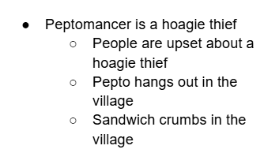

We’ve got the main bullet with the mystery, and 3 sub-bullets that when put together, tell you the main bullet’s “answer”. I can then go on to write a Clue for each sub-bullet that essentially re-words the sub-bullet in-universe.
What’s fun about this approach in theory (didn’t happen too much in practice) was that these mysteries could be nested recursively for more in-depth mysteries. Perhaps there’s two separate Clues that need to be combined for you to reach the conclusion that Peptomancer spends a lot of time in the village.

It’s here I took a break from writing Murder at Loveland Harbor, to focus more fully on my stop motion. It’s the first week of May, and though I have a pretty good picture of the story and know the main mysteries that need to be written, none of the player-facing Clues have been written and there are big gaps or inconsistencies in the rules and character sheets. Google docs spaghetti.

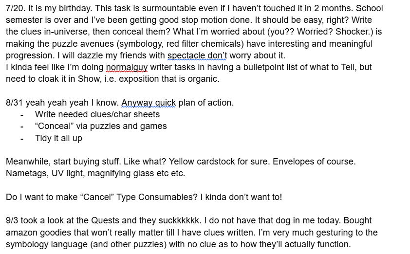

<i>The interlude continues, and the unfinished project hanging over my head does not make for a stress-free summer.</i>

When I came back to this project it was a frenzy of work, and I can’t describe what happened in much more detail than “write Clues, print Clues, hide Clues”. Player-facing info like character sheets was finalized, nametags and envelopes were assembled, and the blank spots of the proverbial map were filled in.

These two weeks of chaos also saw me fixing some major structural issues that I was better able to see with fresh eyes, and my newfound/mandated energy had me accidentally inventing new side-stories. 

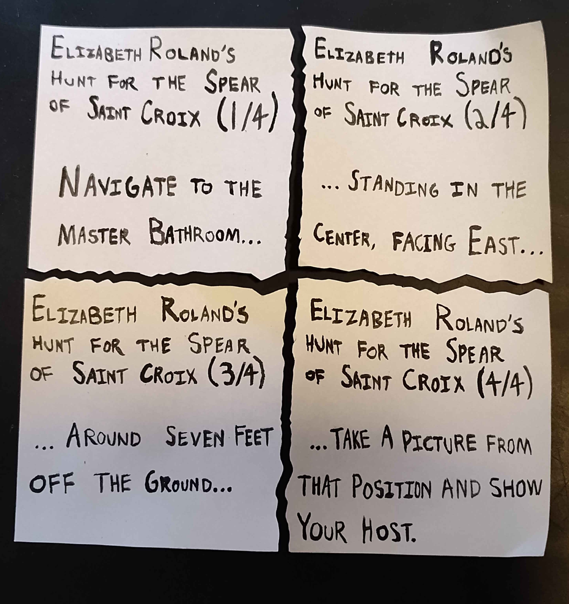

<i>The four map fragments to the Spear of Saint Croix have you take a picture of yourself in my bathroom mirror.</i>

And thats… sort of it? There are game mechanics I haven’t mentioned but aren’t terribly relevant to the design process. Everything was sealed up and hidden around 2 weeks before Halloween, and Katrina did a wonderful job ignoring anything she accidentally stumbled across in that time. Generally speaking, things went super well at Halloween and I couldn’t have asked for a better result given the fact that this wasn’t playtested. 

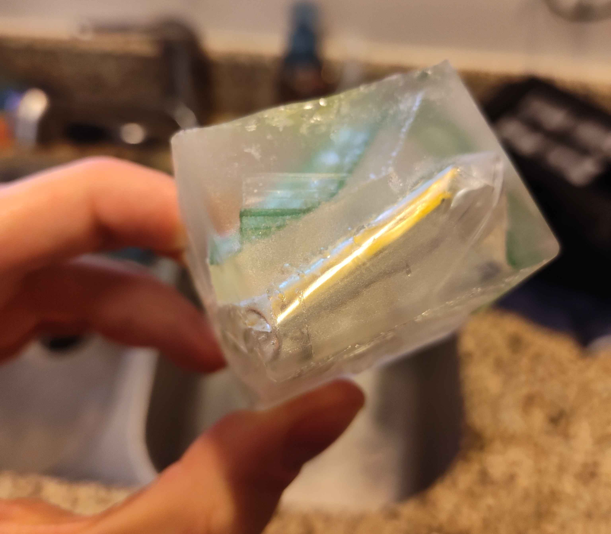

<i>Clue in an ice cube. I'm pretty proud of this one.</i>

## <a href="#head6" id="header6">What I Did That Totally Rocked</a>

<b>General vibes and production</b>. Although the manilla envelopes and post-it-note-sized Clues inadvertently gave this thing an “office supply store” aesthetic, I think the effort I put into trinkets and hiding spots and little jokes made the whole thing so personal and human, there isn’t an ounce of this thing that’s not me. Sticking to the bottom line of just wanting my friends to open goodie bags and discover easter eggs was the correct choice.

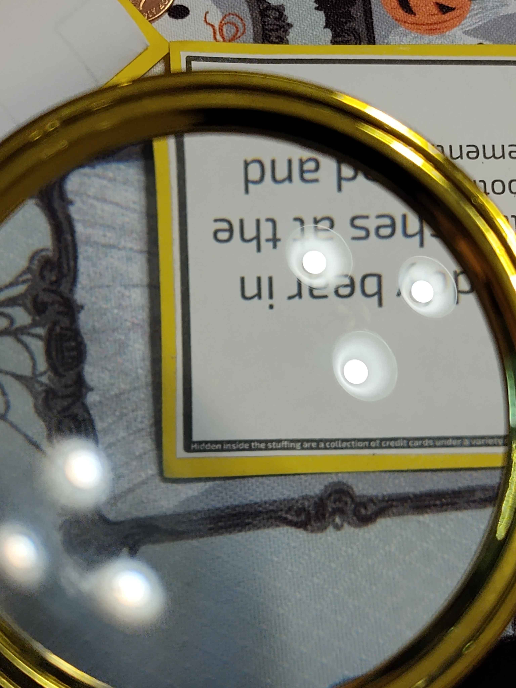

<i>Tiny text hidden within Clues. Sure, anyone could take a pictue on their phone and zoom in, but it's fun to have a magnifying glass!</i>

<b>It was chill!</b> Murder at Loveland Harbor was a remarkably cooperative experience with pretty much no backstabbery. Now this was a double edged sword as I’ll get to later, but I generally see it as a success that the Extreme Gamers among my guests felt this was not cutthroat enough, and my Nonconfrontational Socialites still felt it could’ve stood to be less hostile. While it was a clunky open-world sandbox not to everyone’s ideal speed, no one was left miserable or feeling singled out, which is more than I can say of other games.

<b>Being an active host socially, but not mechanically.</b> Rules-as-written, my only task as Event Runner was to stamp Quest envelopes to denote completion. This was a genius play on my part as I was entirely engaged for the 4 total hours of runtime; mainly answering logistical questions, being curious as to how people were progressing, and generally trying to read the room. What I really think prevented this from being a disaster was realizing when I had written something poorly, and telling stuck players the answers they needed, or just making their task way easier. As time was drawing to a close, I also started moving stuff around in the apartment to make undiscovered Clues more visible, or just flat out revealing them and staring at them until someone realized what I was looking at and collected the free Clue. In both cases, the skillset here is being able to say “hey, I made this too convoluted, that’s on me” and not making people suffer for not thinking along identical lines as myself.

<b>The relationship web (spoiler).</b> Each character has 3 “Relationship” entries on their character sheet; most are asymmetric (player A knows how they know player B, player B doesn’t know this) starting everyone with an idea of who they might want to talk to first. There’s also a few sets of symmetric relationships, a fan-favorite being two characters both having the relationship “[other character] is my identical twin, who I’ve always felt superior to”. 

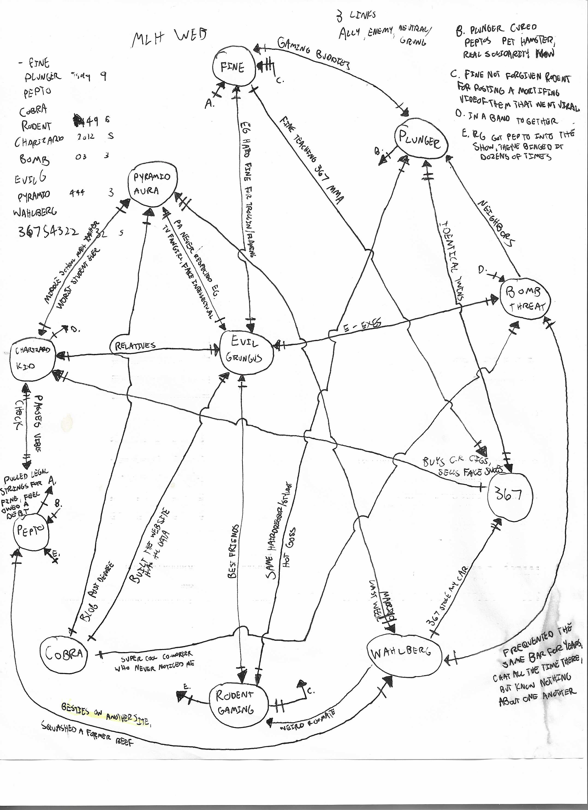

<i>Personal notes. I can't stress enough how normal this diagram looks to me.</i>

<b>Tricky hiding spots :) and a cohesive party.</b> Some wonderful places in which I hid things included: within the Halloween Party invitation sent out around April, a code hidden in a resin-cast magnet I put in the goodie bags of my guests, within my stop motion sort film(!!!), in the commit messages of my website's Github repository, my mailbox (where a postal worker left me a note asking if the Clue was for them), and a QR code cut in half leading to a video where I show you a secret hiding spot. All of the 4th-wall-breaking hints on the reverse side of clues giving the player advice on how to find more difficult Clues were given by the creature from the short film as well. Nobody told me this so I’m probably being arrogant, but I think having every detail of the Halloween party interlink elevated Murder at Loveland Harbor beyond “cool game” and into “I feel like I’m in a Saw trap, is Alex okay?” territory. 

  

    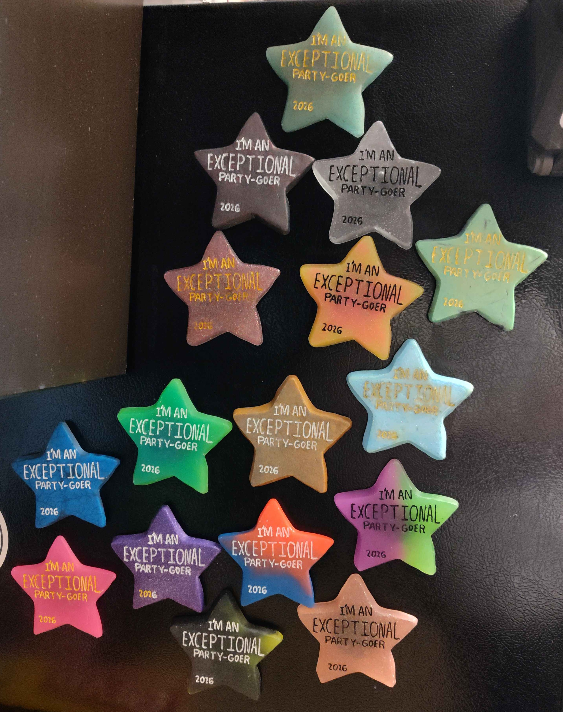
  

  

    
  

<b>Points were made up and did not matter.</b> Maybe this was a bad idea that survived, you’ll be the judge. For each character’s primary and secondary objective, I assigned “points” to them, to indicate how important a task was for that character, with the idea that at the end of the game, whoever tallied the most points might get leftover goodies. This, thankfully, did not matter a bit. No one, not even myself, kept any track of these points and people pursued what they wanted to and ignored the rest. I think it was better to have it and not need it, than to need it and not have it, given how little complexity it added to say “do this thing [+10 Points]”.

## <a href="#head7" id="header7">Bad Ideas I Killed</a>

Here’s some stuff that was dropped before it would work its way into the game, and why the experience would have been so much worse if they were included.

<b>Characters being able to die.</b> Early in development, when this was more a pseudo-clone of Blood on the Clocktower but with a scavenger hunt aspect, I wanted the ability for characters to die within the game mechanics, to add a sense of risk. The tactile-interactive part of my brain thought it might be cool to plant a Clue that’s a bomb or something, and it kills the character who opens it.

Doing any amount of thought on the player-side of things made me realize that No Actually, that would not be fun to immediately get killed off in an only-happens-once bespoke MediaThing. There’s so many ways this was a bad idea<a href="#note3" id="number3">[3]</a>, I’m ashamed it was in my head to begin with.

<b>Mannerisms.</b> So in the character sheet, you’ve got info on your Alibi, aforementioned Relationships, as well as some Secrets and Lore, all of which being “Testimony” you can trade or be forced to give to other people. My early draft also had “Mannerisms” as part of that list, quirks of how a character walked/talked/behaved that would optionally be able to be roleplayed if people wanted to. This should have been dropped immediately as it was not something that any other part of the game interacted with, and I also don’t think 90% of my friends would’ve chosen to roleplay a character in that way. Sadly, the primary reason I dropped this was that I couldn’t think of 2-3 unique mannerisms for each of the 10 characters, and the idea got reworked into the more broadly applicable “Lore”.

<b>“Lurker” side characters.</b> From the beginning I knew I was going to have a primary cast of 10 characters, as I was certainly going to have 10+ party guests, but a narrative game like this with an interconnected cast wouldn’t support another ~6 characters who may or may not appear without affecting the trajectory of the mystery. Such was born the Lurker characters, who had a stripped-down game experience; no character sheet, just a journal and a gimmick to collect points. I thought optional/invisible Lurkers were cute given the whole “terminally online” theme, but I just didn’t bother finishing them and it did not matter, as we only ended up with 11 party guests. Coincidentally, I think the two players who teamed up and the character they got could not have been a more perfect match.

## <a href="#head8" id="header8">Balls I Dropped (Bad Ideas That Survived)</a> 
Sad as I am to admit, Murder at Loveland Harbor was not perfect<a href="#note4" id="number4">[4]</a>. I’m not sure how much you can learn from any of my mistakes, but I’ll own up to them all the same.

<b>Decoding puzzles.</b> One character’s gimmick is that they have this code wheel and can decipher hidden messages. Overall this was a good idea and I’m pleased with the intimidating presence of this concentric-spinner-thing I made. The problem here is that it took far too much time to decode messages, and the player blessed/cursed with this wheel spent most of their time journaling down numbers and letters rather than hunting for Clues and interacting with others.

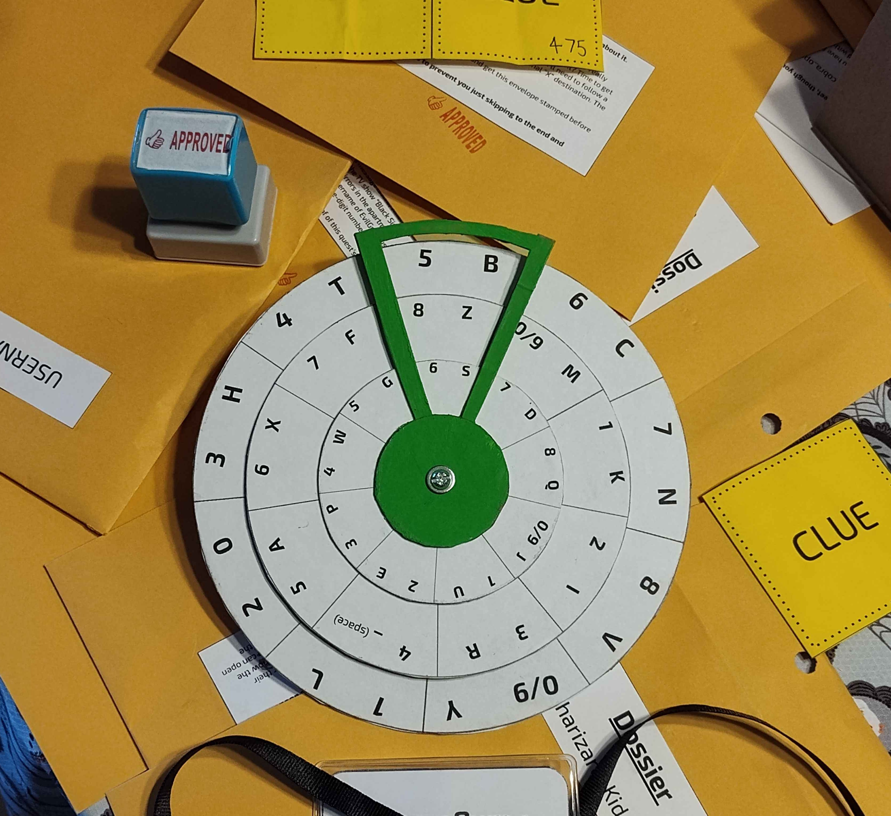

<i>The offending item.</i>

<b>Too much parallel play.</b> This one’s a doozy. In the early stages of design, I wanted to avoid player toxicity and situations where one particular Clue was essential for all players but only one would find it. I overcorrected for this issue by giving everyone different objectives which didn’t interfere with each other, and this resulted in a game experience where most player interactions were “I don’t need this Clue, do you need it for your thing?”. While there were certain quests that required cooperation, consumable Clues to obtain extra info from others, and puzzles which required the tools of multiple players, the composite experience was still generally independent. This was a better alternative than the initial situation I tried to avoid, but not ideal. 

Players had also told me after the game, that because their expectations going into this were of a traditional murder mystery, they were more cagey or secretive than they would have been if they knew this cooperative-competitive game was so heavy on the cooperation. On that note, I probably…

<b>…should’ve just made a co-op game.</b> In addition to what was mentioned in the last section, the antagonistic elements could/should have been dropped entirely. One of the main game mechanics was “extracting a confession” giving another player Clues and forcing them to answer any question by giving you one of their Testimony slips, but this mechanic was seldom used. 

There was also a box of Dossiers, which were yet another envelope for each player to hold the evidence used in their final case. The idea was that these Dossiers could be a safe place for a player’s collected Clues and Testimony, safe from the meddling of other players, but for better or worse<a href="#note5" id="number5">[5]</a>, there weren't enough offensive interactions to make this “protected zone” necessary.
Making a game like this be fully co-op would need to be one of the first decisions made, and the classical murder mystery theming would probably need to be rethought. A lot would change but if for whatever reason I made another one of these, it would be a purely cooperative, escape room type thing.

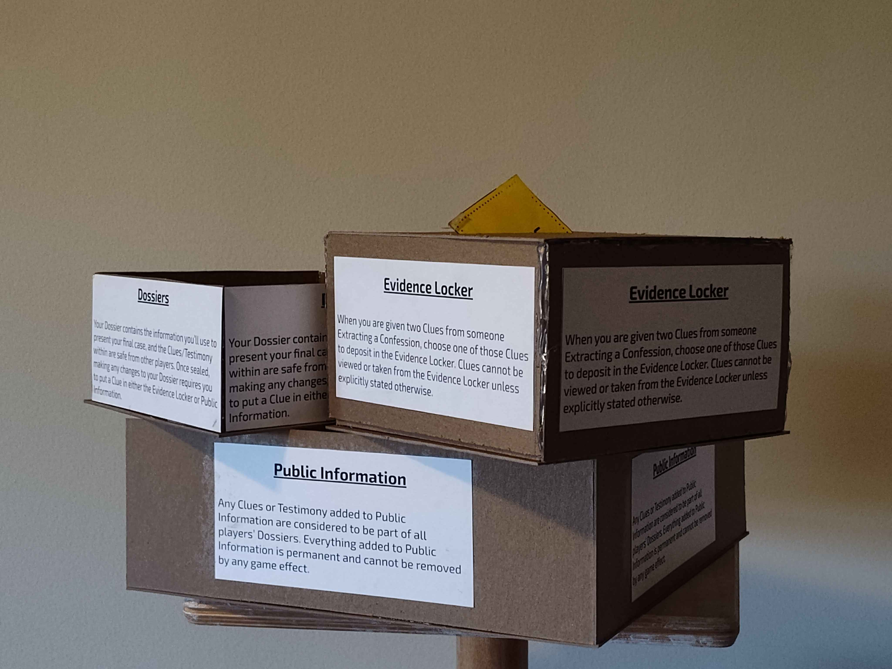

<i>The other two containers did serve their purpose well.</i>

<b>Goofs and Bloopers.</b> There were relatively minor amounts of genuine mistakes on my part; I counted one typo in a Clue, one lockbox I forgot to hide anything of value in (that was never opened to begin with), and two Clues that I forgot to give a special ID which hinted at the secret contained within (though the secret was still there to the discerning eye). If you download the game materials, those have since been fixed, or at least acknowledged. Leading up to Halloween, I was so positive that I had left a huge bug in Murder at Loveland Harbor that would make the game entirely trivial or totally impossible, and the fact that these errors were as bad as it got baffles me.

<b>Wide as an ocean, deep as a puddle.</b> Time for my confession. Murder at Loveland Harbor, for all of the hype I give it, is really not that great from an objective standpoint. The tools and motifs of each character are gimmicks, and I especially dropped the ball with the Sigil motif, which began as a fully complete Symbology conlang puzzle box, but got less ambitious as the deadline approached, and I needed to pave the road in real-time for the player who got stuck with those puzzles. The nested mysteries I mentioned earlier scarcely happened, and almost every objective or solution was just finding any 2 items in a given set of 3 Clues. I am not a mad scientist, I am not a master tactician. I am an illusionist, a charlatan.

BUT! That is okay! I wanted to surprise you with spectacle, get you excited to find hidden treasure, and blow you away with how many other concurrent plotlines were going on at the final reveal. I am honored that my presentation of the affair was impressive enough that people were not only engaged in solving some of the most esoteric riddles I could think of, but coming up with new conspiracies I hadn’t even considered. You suspended your disbelief and bought into the illusion. Even if the magic isn’t real, the show was fun to watch, and that’s enough for me to count it as a win.

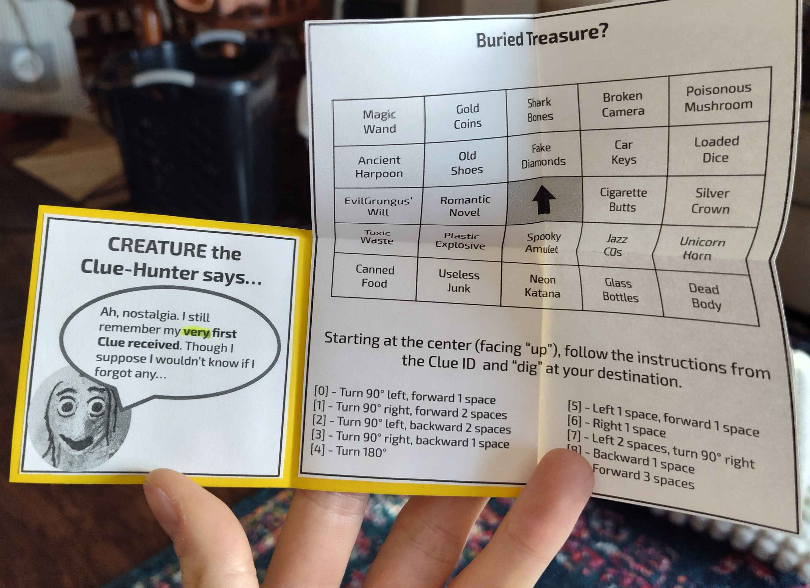

## <a href="#head9" id="header9">What I Learned About Interactive Media And My Friends And Isolation Is…</a>
...a tad melancholic so I’ll be brief. Because of how much time I worked on Murder at Loveland Harbor, I became a bit blinded to how fresh eyes would see the world I could recite from memory<a href="#note6" id="number6">[6]</a>. There were a few moments during the event, where I realized people hadn’t read crucial parts of their character sheet or missed Clues that were in an envelope they just opened. This is to be expected, as everyone’s goal is to have fun at the Halloween party and not read every scrap of text cover to cover. I will skim writing that isn’t mine, but it wounds my fragile little ego to see others skim my own words.

A great example of how out of touch I made myself is when people told me afterward, “despite all the mechanics things weren’t that hard to follow”, and I thought to myself, “what mechanics? There’s like only two ‘game rules’ max. Do you understand how streamlined and uncomplicated this whole thing is??”.

I guess that’s a tricky thing about games, that they aren’t really complete until the audience interacts with them. If you don’t fully get Posthuman Lament I couldn’t be bothered, as it will still exist. Designing a game (especially of this magnitude) requires me to sacrifice control of my work, it’s like writing a play where the actors are also the audience; once the show starts it’s out of my hands, but if people don’t have fun it reflects poorly on me. How does my design account for players who collect a bunch of Clues, don’t approach others and aren’t approached by others?

Murder at Loveland Harbor was developed in complete isolation, as all the folks who I would normally bug about game design thoughts were going to be participants. That definitely shows in the finished product, and I think I’m a bit turned off from making game-type stuff (maybe just tabletop stuff, I still want to make digital games) in the near future. I know I’m not properly unpacking the weird symbiotic relationship between Game Designer and Game Audience here, but it’s something that doesn’t sit quite right with me. Like, players are co-creators of a work who are rarely aware of their role as artist<a href="#note7" id="number7">[7]</a>. That being said though, the end of Murder at Loveland Harbor was phenomenal, and when players argued their final cases to the group it was exactly the shitshow I had hoped it would be. 

## <a href="#head10" id="header10">Lore and Spoilers</a>
Here’s a general summary of everything that goes on in the game. The island of Loveland Harbor, off the coast of the (actually real) Matinicus Isle, Maine, has always been something of a local legend, rumored to be haunted for the unnatural amount of sunk or missing vessels in that tiny sector of the Atlantic. The dangerous waters and discrete location had for many years made it a rare destination for smugglers to trade contraband, if they weren’t afraid to risk a shipwreck. One such vessel was the Deliverance, captained by Elizabeth Roland. Unlike most ships the island claimed, there were survivors when the Deliverance ran aground in 1818. Captain Roland’s obsession with finding the mythical Spear of Saint Croix, which had always been brewing under the surface, began to boil over as her crew was starting to make the island (which they had named Grenouille) habitable. In her tyrannical madness, Roland began to slaughter her crew, convinced that blood sacrifice would lead her to the Spear, before eventually being killed by her first mate and aspiring author Jerimiah Hazletop. Though the Spear of Saint Croix was not discovered, Roland’s final deed on earth was uncovering an amulet bearing a similar sigil to the glyphs that would eerily form in the clouds over the island, or the patterns which lichen would form on trees.

We skip ahead to 1849, where American Transcendentalist Ralph Waldo Emerson<a href="#note8" id="number8">[8]</a> purchases the island for a summer home, not heeding the warnings from the Matinicus Isle Historical Society about the monsters and death which await all who set foot on the island. He and his family settle for less than a month, and while they do not have a direct encounter with the supernatural, the intense emotions and dreams they experience cause them to leave the island they erroneously spell “Greenway”, and relocate back to Massachusetts.

And now enters our main cast of characters. An internet dweller by the username **EvilGrungus** becomes obsessed with the defunct TV show Black Sight (2010-2011), a 1-season chaotic jumble of conspiracy theories, globe-trotting adventures, 1960’s Cold War politics, and aliens. EvilGrungus joins a small fangroup of the show and quickly becomes the center of attention, pushing the former leader (username **b0mb_thr3at**) to the wayside. Due to the show’s almost-forgotten nature, the “Terrestrials” forum, named after the one of the (many) secret societies in the show, grows to around a dozen members. In the years leading up to the events of Murder at Loveland Harbor (~2016-2026), EvilGrungus grows more obsessed with the occult, and convinced of secret messages being transmitted within the episodes of Black Sight.

Around a year prior to the main events, Loveland Harbor is bequeathed to EvilGrungus from their grand-aunt, who had purchased the land in 1981. Obsessed with the supernatural as well, the (unfortunately nameless) grand-aunt was aware of a great power lurking beneath the island, something sentient and malevolent. Without a way to harness or control the creature, she searched in vain, turning the hidden caches left by smugglers into a network of tunnels, excavating for decades in search of a way to contact this Amphibian Presence. When EvilGrungus took up the mantle of this family quest, the preparations to settle the thrice-named “Loveland Harbor” (in reference to the Ohio cryptid, naturally), began in full, though to the other members of the Terrestrials, the offer provided was of a sovereign island utopia. Elsewhere, another scheme begins, as EvilGrungus’ first cousin once removed (a gambling addict by the username **Charizard_Kid_2012**), is made aware of their relative’s inheritance and starts integrating into the Terrestrials forum with the intent of stealing ownership.

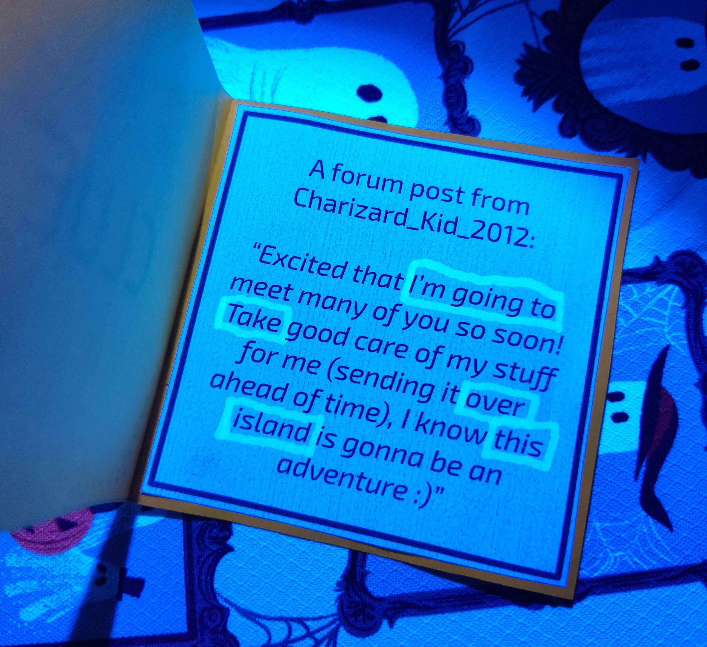

<i>A clue with UV markings revealing a hidden message!</i>

October 2026. EvilGrungus has finished with the preparations of Loveland Harbor, having constructed “The Lab”, a flimsy base of operations that’s the closest thing to a real building on the island, as well as having further developed the underground chambers, where magickal instruments are stored and transported as needed. The rest of our cast arrives to the island in short order, and quickly discovers that paradise is not what was advertised, yet struggles forward:

\- **_pyramidAura444**, a professor hoping to discover new species on the island, secure funding to research it further, and kick everyone else out.\
\- **RodentGaming49**, who sees this cult for what it is and starts recording everything to gather material for a documentary.\
\- **cobra_operative**, who has no history with the others aside from designing the Terrestrials website, and hopes to gather proof of the many concurrent scams in a misguided attempt to secure a job at the IRS.\
\- **MarkWahlbergOfficial**, an amateur mystery novelist who is sick and tired of the island until a murder takes place.\
\- **Peptomancer**, a jack-of-all-trades with shifting loyalties and an extensive hamster terrarium abandoned to join the chaos.\
\- **everythingisfine**, a belligerent Terrestrial focused on causing the most damage and getting as many people arrested as possible when everything goes down.\
\- **Plunger9999** and their identical twin **36754332**, more on them in a bit.

Food supplies dwindle and tensions rise almost immediately, with everything coming to a head on October 30th. EvilGrungus has planned a ritual for the evening mirroring the blood sacrifice of Captain Roland centuries ago, to harness the power of the froglike monster slumbering on the island, which they’ve named “Lord Ordresh” in yet another reference to Black Sight. b0mb_thr3at chooses today to enact their vengeance upon EvilGrungus, poisoning a thermos of coffee, which is never drunk, absolving b0mb_thr3at of the murder they intended to commit. Rather, the little dictator of the island is struck down by Plunger9999, who had correctly suspected that something terrible would occur that night, and attacked EvilGrungus with a large stone which was then cast into the sea. The body remained undetected for some time in the island’s old village, until gunshots were heard, which most at first assumed were the origin of the murder. In reality, 36754332, who had consumed a dangerous dose of a local “delicacy” known as Pigeon Liquor, had broken into EvilGrungus’ lab to steal a firearm and fired shots at a massive abomination crawling out of the Harbor’s central pond, which could have been a hallucination but was in fact quite real, and promptly passed out again.

From checking the hidden cameras they had installed, RodentGaming49 saw the blood spilling out of a doorway in the village, but not the perpetrator, and notified the police of the murder on their secret radio station in the island’s woods. With a killer and a monster on the loose, and authorities on their way, the hunt for answers (and the game experience) begins.

## <a href="#head11" id="header11">Raw Materials</a>
An now for everything I made for Murder at Loveland Harbor. These are only finished documents. I’m not including half-baked brainstorm docs, though there’s a few of those. Everything in the following resources got printed out and assembled. Any text in red is me explaining some things to you after the fact, for clarity. 

I’m dubious about the long-term archival of shared Google docs, so I’ve downloaded things as .pdfs and put them in my Github repo (which feels less sketchy than a button on my site to download a mysterious .zip). If for whatever reason you want the actual docs and slides, let me know.

[Resources :)](https://github.com/alexkuzel/alexkuzel.github.io/tree/main/assets/pdfs/MLH)

This was a behemoth of a post and I still have more to say. Thank you for reading!

## <a href="#head12" id="header12">Footnotes</a>

<a href="#number1" id="note1">[1]</a> Listing the components exhaustively so you realize how insane I was about this.

<a href="#number2" id="note2">[2]</a> Yes I am defining my terms used, I can't help it. This post was either going to make sense, or be short, so I went with the former. Hopefully.

<a href="#number3" id="note3">[3]</a> Including but not limited to having a tiny envelope to be opened upon your death explaining how the Ghost rules work. What was I thinking.

<a href="#number4" id="note4">[4]</a> Oh, you weren’t at the party? Uh yeah actually nevermind it was perfect and such a transcendent experience you just just had to have been there to know, y’know?

<a href="#number5" id="note5">[5]</a> Better. I’m so glad this wasn’t needed actually.

<a href="#number6" id="note6">[6]</a> Not an exaggeration, 2 weeks after its all said and done, I think I could still recite every character’s quests, objectives and Testimony.

<a href="#number7" id="note7">[7]</a> I talk more about this and related topics in the Posthuman Lament bonus features.

<a href="#number8" id="note8">[8]</a> Real guy, fake lore.

